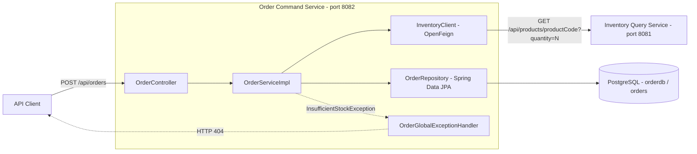
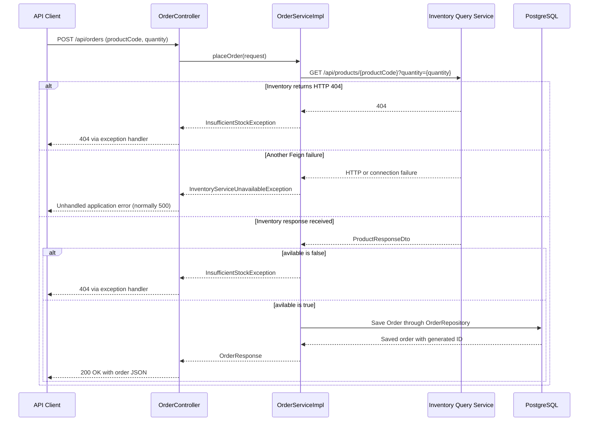

# Order Command Service

A Spring Boot service that accepts order requests, checks product availability through the Inventory Query Service, and persists accepted orders in PostgreSQL.

## Technology stack

Versions below reflect the repository configuration:

| Component | Configuration |
| --- | --- |
| Java | 17 |
| Spring Boot | 4.1.2 |
| Spring Cloud | 2025.1.4 |
| Maven wrapper distribution | 3.10.0 |
| HTTP API | Spring Web MVC |
| Inventory client | Spring Cloud OpenFeign |
| Persistence | Spring Data JPA / Hibernate, PostgreSQL |
| Boilerplate generation | Lombok |

## Architecture



| Package | Responsibility |
| --- | --- |
| `controller` | Exposes the order creation endpoint. |
| `service` | Checks availability, creates an order, and maps the saved entity to a response. |
| `client` | Calls the external inventory HTTP API. |
| `repository` | Persists orders through `JpaRepository<Order, Long>`. |
| `entity` | Maps `Order` to the `orders` table. |
| `dto` | Defines order requests, responses, inventory responses, and error responses. |
| `exception` | Defines business exceptions and the custom HTTP 404 handler. |

## Execution flow



An accepted order stores the inventory response's product code, product name, and `avilableQuantity`, together with `LocalDateTime.now()` and a database-generated ID. The response contains the ID, product code, stored quantity, and creation time.

## Prerequisites

- JDK 17 with `JAVA_HOME` configured.
- PostgreSQL running and accessible to the application.
- An Inventory Query Service implementing the contract below.
- Network access to resolve the configured Maven distribution and dependencies on the first build.

The inventory service is a separate application and is not included in this repository.

## Run locally

### 1. Clone the repository

```powershell
git clone https://github.com/janandlead/Order-Command-Service.git
cd Order-Command-Service
```

### 2. Create the database

Connect to PostgreSQL as a user allowed to create databases:

```text
psql -h localhost -p 5432 -U postgres
```

Run this SQL once:

```sql
CREATE DATABASE orderdb;
```

Hibernate uses `spring.jpa.hibernate.ddl-auto=update` to create or update the application tables at startup. The database itself must already exist.

### 3. Configure the application

Defaults are defined in [application.properties](src/main/resources/application.properties).

| Environment variable | Default / requirement |
| --- | --- |
| `DB_PASSWORD` | Required by the default datasource password configuration. |
| `SPRING_DATASOURCE_URL` | `jdbc:postgresql://localhost:5432/orderdb` |
| `SPRING_DATASOURCE_USERNAME` | `postgres` |
| `INVENTORY_SERVICE_URL` | `http://localhost:8081` |
| `SERVER_PORT` | `8082` |

In PowerShell, set the password in the terminal used to launch the service:

```powershell
$env:DB_PASSWORD = '<your-local-postgres-password>'
# Optional overrides:
$env:INVENTORY_SERVICE_URL = 'http://localhost:8081'
$env:SPRING_DATASOURCE_URL = 'jdbc:postgresql://localhost:5432/orderdb'
$env:SPRING_DATASOURCE_USERNAME = 'postgres'
```

For Bash:

```bash
export DB_PASSWORD='<your-local-postgres-password>'
export INVENTORY_SERVICE_URL='http://localhost:8081'
```

### 4. Start the dependencies and service

Start PostgreSQL, then the Inventory Query Service on port `8081`. Ensure inventory contains the product you will order.

Start this service from the repository root in PowerShell:

```powershell
.\mvnw.cmd spring-boot:run
```

On macOS or Linux:

```bash
sh mvnw spring-boot:run
```

The order endpoint is available at `http://localhost:8082/api/orders` once startup completes. Stop the process with `Ctrl+C`.

### 5. Submit an order

PowerShell:

```powershell
$body = @{ productCode = 'SKU-001'; quantity = 2 } | ConvertTo-Json
Invoke-RestMethod -Uri 'http://localhost:8082/api/orders' -Method Post -ContentType 'application/json' -Body $body
```

Bash:

```bash
curl -X POST http://localhost:8082/api/orders \
  -H 'Content-Type: application/json' \
  -d '{"productCode":"SKU-001","quantity":2}'
```

Example `200 OK` response, assuming inventory returns `avilableQuantity: 2`:

```json
{
  "orderId": 1,
  "productCode": "SKU-001",
  "quantity": 2,
  "createdAt": "2026-11-08T14:30:00"
}
```

The ID and timestamp are generated at execution time. To inspect persisted orders, connect to `orderdb` and run:

```sql
SELECT * FROM orders ORDER BY id DESC;
```

## Inventory API contract

The Feign client calls:

```http
GET /api/products/SKU-001?quantity=2
```

Expected response shape:

```json
{
  "productCode": "SKU-001",
  "productName": "Sample Product",
  "avilableQuantity": 2,
  "avilable": true
}
```

The spellings `avilableQuantity` and `avilable` match the current DTO and must be preserved by the inventory response. Availability is determined by `avilable`; this service does not independently compare available stock with the requested quantity.

## Error behavior

| Condition | Current outcome |
| --- | --- |
| Inventory returns HTTP 404 | HTTP 404 with `Product not found: <productCode>`. |
| Inventory returns `avilable: false` | HTTP 404 with `Insufficient stock for product: <productCode>`. |
| Another Feign error occurs | Throws `InventoryServiceUnavailableException`; no dedicated handler is defined, so this normally becomes HTTP 500. |

Example custom error body:

```json
{
  "timestamp": "2026-11-08T14:30:00",
  "status": 404,
  "error": "Not Found",
  "message": "Insufficient stock for product: SKU-001",
  "path": "/api/orders"
}
```

## Build and test

Run the existing application-context test with PostgreSQL configured and available:

```powershell
.\mvnw.cmd test
```

The test loads the Spring application context; it does not submit an order or exercise the inventory HTTP call.

Build an executable JAR, running tests as part of the build:

```powershell
.\mvnw.cmd clean package
java -jar target/Order-Command-Service-0.0.1-SNAPSHOT.jar
```

To package without executing tests:

```powershell
.\mvnw.cmd clean package -DskipTests
```

For macOS/Linux, replace `.\mvnw.cmd` with `sh mvnw`. Keep the database environment variables set when launching the JAR.

## Current implementation limits

- The saved order quantity comes from inventory's `avilableQuantity`, not directly from the requested `quantity`.
- The inventory call only checks stock. No reservation or stock decrement is implemented, so the check and order insert do not guarantee stock allocation under concurrent requests.
- Requests have no Bean Validation constraints for missing product codes or non-positive quantities.
- There is no idempotency mechanism; repeated successful POST requests can create multiple orders.
- The repository currently exposes only order creation, with no order-query endpoint, authentication configuration, event publishing, or explicit inventory retry/circuit-breaker configuration.

## Troubleshooting

| Symptom | Check |
| --- | --- |
| Database connection or authentication failure | PostgreSQL is running, `orderdb` exists, and datasource credentials are correct. |
| Unresolved `DB_PASSWORD` placeholder | Set `DB_PASSWORD` in the same terminal before starting the service. |
| Order call fails while inventory is offline | Start inventory and verify `INVENTORY_SERVICE_URL` and its endpoint. |
| An available product is treated as unavailable | Verify the inventory JSON uses the exact `avilable` field name. |
| Port 8082 is already in use | Stop the conflicting process or set `SERVER_PORT` to a free port. |
| Maven wrapper or dependency resolution fails | Check access to the configured artifact repositories and availability of the exact versions in `pom.xml` and `.mvn/wrapper/maven-wrapper.properties`. |
